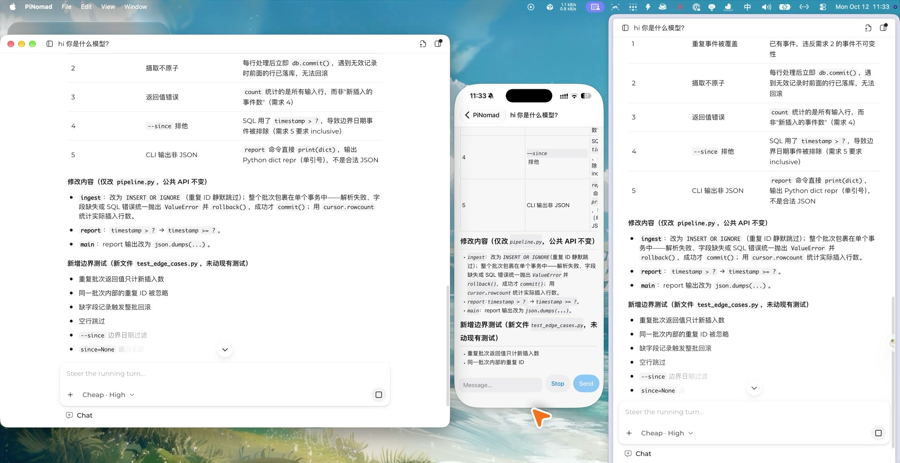

# PiNomad

English · [中文](README.zh-CN.md)

A self-hosted coding agent built on [Pi Durable](https://www.npmjs.com/package/@earendil-works/pi-durable). The agent runs on your own machine; the Mac app, the web client, and the iPhone app all attach to the same runs.



<sub>One run, three clients: Mac app (left), iPhone via iPhone Mirroring (center), web (right). The host is a Linux box on the same tailnet.</sub>

- **Your machine does the work.** The host runs on a Mac mini, a Linux box, or a VPS, and the agent uses that machine's shell and repositories.
- **Runs survive crashes and restarts.** Pi Durable checkpoints every model call and tool call, so a restarted host picks up where it stopped.
- **Clients are just windows.** Start a task at your desk, then check on it or steer it from your phone. Devices pair with a one-time QR code and talk to the host over an end-to-end encrypted channel: directly on your LAN or tailnet, or through a relay that only sees ciphertext.

> **Status:** early and moving fast. Pi Durable is itself experimental, and the host and its clients must speak the same protocol major version.

## Quick start

The host needs Node 25+ on macOS or Linux.

```sh
npm i -g pinomad
pinomad host        # uses the models and credentials you set up in pi (~/.pi/agent)
pinomad link        # in another terminal: prints a browser link to the web client
```

Haven't set up pi yet? `pinomad host --faux "hi"` runs a scripted fake model so you can click around.

## Connect your other devices

Open a port for paired devices, then pair each device with its own QR code:

```sh
pinomad host --remote-port 7422
pinomad pair        # one-time QR code and link, expires after 5 minutes
```

Scan the code with the iPhone app, or paste the link into the Mac app. The remote port accepts paired devices only; revoke them under Devices in the sidebar.

The pairing link uses the LAN address the host detects. On a tailnet or behind a tunnel, add `--public-url http://<tailnet-ip>:7422` so the link points there. To reach a host at home from anywhere, run the relay on a VPS: see [Remote access](docs/remote-access.md).

## Keep it running

Install the host as a user service (LaunchAgent on macOS, systemd user unit on Linux) so it starts at boot and restarts on crash:

```sh
pinomad service install --remote-port 7422
pinomad service status
pinomad upgrade     # install pinomad@latest, wait for running tasks, restart
```

Service flags, logs, and platform caveats: [Running as a service](docs/service.md).

## Clients

| Client | How to get it |
|---|---|
| Web | Served by the host itself (`pinomad link`) and by the relay; any modern browser |
| macOS (Apple silicon) | Signed DMG from [GitHub Releases](https://github.com/bubbleptr/pinomad/releases); updates itself |
| iOS | Internal TestFlight only for now |
| Linux, Windows | Use the web client |

## What the agent can do

The agent has pi's four tools (read, bash, edit, write) plus:

| Feature | What it does |
|---|---|
| Projects and worktrees | Register a directory as a project. In a Git repo each conversation works in its own worktree and branch, so your checkout stays untouched |
| Forks | Branch off from a message and keep both lines going |
| Subagents | Hand self-contained tasks to subagents that run in parallel |
| Questions, not approvals | Tools run without approval prompts; when the direction is unclear, the agent asks 1–4 multiple-choice questions |
| codemode | The model writes JavaScript that calls other tools in a QuickJS sandbox; only the script's output enters the context |
| MCP | Servers configured in `~/.agents/mcp.json`, in the usual `mcpServers` format |
| AGENTS.md and skills | Reads `AGENTS.md` / `CLAUDE.md` and skills from `~/.agents` and the project, on every request |

Details and the MCP config reference: [Usage](docs/usage.md).

## Documentation

These docs are written in Chinese.

| Doc | Covers |
|---|---|
| [Usage](docs/usage.md) | Projects, worktrees, tools, MCP configuration |
| [Remote access](docs/remote-access.md) | Pairing, tunnels, self-hosted relay (VPS or container platforms) |
| [Running as a service](docs/service.md) | `service` and `upgrade` commands, platform notes |
| [Architecture decisions](docs/adr/README.md) | Why things are the way they are |
| [Roadmap](docs/roadmap.md) | What's done and what's next |
| [Glossary](CONTEXT.md) | Domain terms |

## Contributing

Running from source, verification, and the release process are in [CONTRIBUTING.md](CONTRIBUTING.md) (Chinese).

## License

[Apache-2.0](LICENSE). PiNomad includes code adapted from [Pi](https://github.com/earendil-works/pi) (MIT) and other projects; their notices are in [`docs/licenses/`](docs/licenses/).
