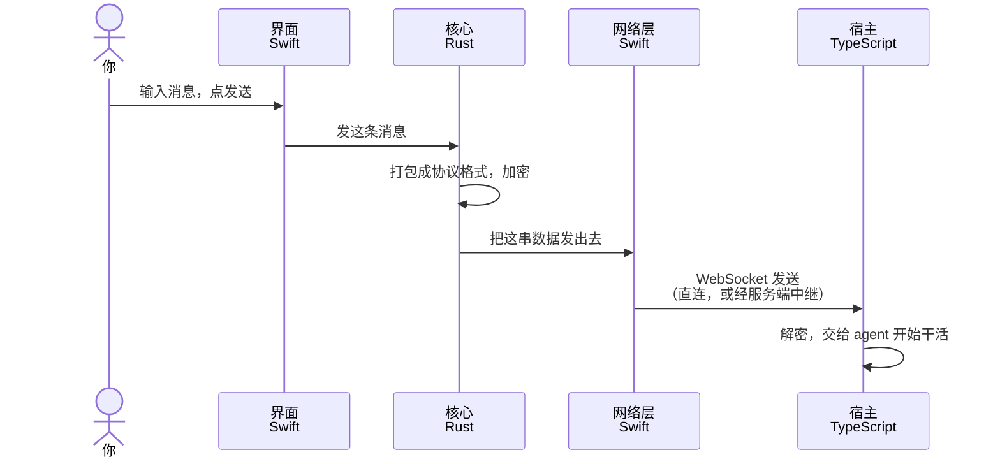
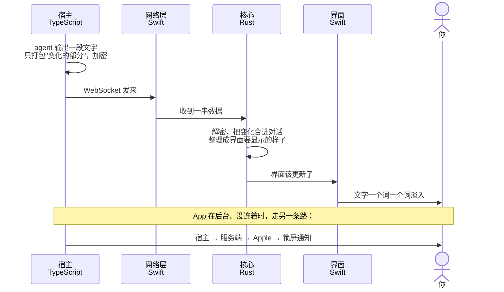

# 架构概览

PiNomad 由宿主、服务端和几种客户端组成，用到 TypeScript、Rust、Swift 三种语言（以后加 Kotlin）。这篇只讲各部分是什么、怎么配合；为什么这样设计见 [ADR 索引](adr/README.md)，尤其是 ADR-0003（宿主和客户端）、ADR-0022（服务端）、ADR-0024（原生移动端和 Rust 核心）、ADR-0025（推送）。

## 各部分和语言

| 部分 | 位置 | 语言 | 做什么 |
|---|---|---|---|
| 宿主 | `apps/host` | TypeScript（Node） | 跑在你的电脑上，真正干活：跑 agent、读写代码、存对话 |
| 服务端 | `apps/server` | TypeScript（Node） | 账号；外网连不上家里时转发加密数据（看不到内容）；持有推送密钥，代宿主给 Apple 发通知 |
| Web / 桌面端 | `apps/web`、`apps/desktop` | TypeScript + React | 直接用 `packages/protocol`（协议）和 `packages/client`（界面数据的推导） |
| 移动端核心 | `crates/pinomad-core` | Rust | 手机端的"大脑"：加密、协议、同步数据、整理界面要显示的内容；iOS 和安卓共用一份 |
| iOS App | `apps/ios`（还没建） | Swift | 只管界面（SwiftUI + AgentChatKit）和替 Rust 收发网络数据 |
| 安卓 App | `apps/android`（以后） | Kotlin | 和 iOS 一样，只是换成 Compose |
| 旧移动端 | `apps/mobile` | TypeScript（Expo） | 维护期，原生版替换后删除 |

## 怎么配合

1. **大家说同一种"话"。** 所有客户端连宿主都用同一套协议：WebSocket 传数据，Noise 加密，局域网或 tailnet 直连，外网时经服务端中继。宿主分不出对面是 Web 还是 iOS。
2. **TypeScript 是协议的标准。** 协议和推导在 TypeScript 和 Rust 里各有一份实现。TypeScript 生成一批 JSON 格式的标准答案（`packages/protocol/test/fixtures/rust-vectors/`），Rust 的测试拿同样的输入跑，结果必须一模一样；改了 TypeScript 却没改 Rust，测试会失败。
3. **Swift 和 Rust 之间有一座自动生成的桥（UniFFI）。** Rust 不碰网络：网络消息到了，Swift 交给 Rust；Rust 处理完，告诉 Swift 发什么、界面怎么变。所以手机的网络行为（VPN、后台、权限）都由系统决定。
4. **宿主和服务端只有 TypeScript 一份。** 它们跑在电脑和服务器上，不需要别的语言。

## 发：你在手机上发一条消息

## 收：agent 的回复显示到手机上

Web 和桌面端的流程一样，只是中间三格都是同一个 TypeScript 程序。以后的安卓把两头的 Swift 换成 Kotlin，中间的 Rust 原样复用。

## 性能：中间层会不会拖慢

Swift 调一次 Rust 只要几微秒，聊天每秒也就几十次小更新，桥本身不是瓶颈；加密和数据处理放在 Rust 里，比 Expo 版里的 JavaScript 快。真正要防的是每次过桥带的东西太多，例如 agent 每吐一个词就把几百轮带图片的完整对话复制一遍。ADR-0024 §5 规定了更新带版本号、条目有稳定 ID、来得太密的更新合并；每次传整份还是只传变化，在 iOS 骨架那一步用真机长对话实测后决定。画 Markdown、代码高亮、文字淡入都在 AgentChatKit 里，是纯 Swift。
